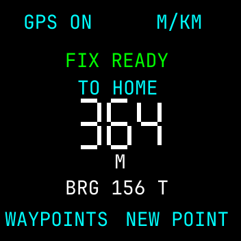

# Bip Outdoor for Amazfit Bip

Offline GPS waypoint navigation and outdoor tools for the **original Amazfit Bip (A1608)** running **BipOS**. Save a trailhead on the watch, then see how far away it is and the bearing back. Navigator works offline after installation.

- **Navigator** has six waypoint slots, large distance digits, and metric or nautical units. Save a point in an empty slot and select it as your return target. Within a displayed 10 m, the screen switches to **NEAR TARGET**.
- **GPS Diagnostic and Compass Check** show what the watch is reporting. Navigator displays a numeric true-north bearing.
- **Sun and barometer tools** include sunrise, sunset, twilight, and experimental pressure and altitude readings. Tide predictions require a separately obtained data snapshot.

The build targets **BipOS 0.5.5 build 7 on English non-Latin 1.1.2.05**. An earlier build acquired a GPS fix and kept a saved waypoint through a restart on that setup. The current trailhead build passed local checks and awaits a field test.



## Build and try it

On x86-64 Linux, install Git, Make, GCC, Python 3, curl, tar and bzip2. Use Node.js for the RES tooling.

```sh
make bootstrap package-tools
make check
```

The build puts the ARM apps in `build/*.elf`. The local screen preview is at `build/preview/screens.svg`. For the exact BipOS base and resources-only packaging steps, see [Installation](docs/INSTALL-SUITE.md). For the controls and a short walk test, see [Navigator](docs/WAYPOINTS.md).

This repository contains source. To build an installable RES, obtain the matching BipOS resources from their upstream distribution. See [upstream components](NOTICE.md) for attribution and [BipOS sources](docs/BIPOS-SOURCES.md) for compatibility notes.

## License

Project code is available under [Apache-2.0](LICENSE). [Upstream notices](NOTICE.md) apply to separately obtained components.
